# kz-skills: UI rules for AI coding agents, with checks that measure them

**Your agent learns what any interface must do, what breaks when it does not, and runs a browser check that proves it.**

<a href="https://kz-95.github.io/kz-skills/reference/ui-rules-visual.html"></a>

94 rules (57 UI, 6 motion, 21 chart, 10 diagram) and 16 principles, in thirteen skills, with ten browser checks.
Stack-neutral and style-neutral: they work with any framework and any look.
Plain Markdown, so any agent that reads files can use them.

## Install

```bash
npx skills add kz-95/kz-skills
```

The [`skills` CLI](https://skills.sh) finds every skill in this repository and installs it into the skills folder of each agent you pick (Claude Code, Cursor, Codex and others).
Add `-l` to list the skills without installing, or `--skill kz-uiuxrule` to take one.

In Claude Code, as a plugin:

```text
/plugin marketplace add kz-95/kz-skills
/plugin install kz-skills@kz-skills
```

From a terminal, the same two steps are `claude plugin marketplace add kz-95/kz-skills` and `claude plugin install kz-skills@kz-skills`.
The plugin installs and enables all thirteen skills.
Then `/kz-uiuxrule`, or `/kz-skill` if you are not sure which one.

<details>
<summary><b>Claude Code</b>, by hand (macOS, Linux, Windows)</summary>

```bash
git clone https://github.com/kz-95/kz-skills.git
cp -r kz-skills/skills/* ~/.claude/skills/
```

On Windows PowerShell:

```powershell
git clone https://github.com/kz-95/kz-skills.git
Copy-Item kz-skills\skills\* $HOME\.claude\skills -Recurse
```

Each skill must land as a **direct** child of `skills/`.
A skill nested inside another folder is not registered, and will not appear as a command.

</details>

<details>
<summary><b>GPT, Codex, Cursor</b> and other agents</summary>

The skills are plain Markdown.
Point your agent at [`AGENTS.md`](AGENTS.md), which tells any agent how to use them, and at [`llms.txt`](llms.txt), the index for crawlers and file-reading models.
[`docs/install.md`](docs/install.md) has the details per host.
The checks are `.js` files you paste into a browser console, so they need no host at all.

</details>

<details>
<summary><b>Only part of it</b></summary>

`npx skills add kz-95/kz-skills --skill kz-diagramrule` takes one skill.
`kz-uiuxrule` links to `kz-engrules`, `kz-askcard` and `kz-uicheck` as siblings, so install those four together if you want the rules without the crew.

</details>

[Live reference](https://kz-95.github.io/kz-skills/reference/ui-rules-visual.html) | [All 94 rules](docs/rule-index.md) | [For agents: llms.txt](llms.txt) | [Changelog](CHANGELOG.md)

**On this page:** [Ask in plain words](#ask-your-agent-in-plain-words) | [Why](#why-this-exists) | [What it covers](#what-it-covers) | [How it compares](#how-it-compares) | [The skills](#the-thirteen-skills) | [What loads when](#what-loads-when) | [Most missed](#the-rules-most-often-missed) | [FAQ](#faq) | [Contributing](#contributing) | [License](#license)

---

## Ask your agent in plain words

- *"Build a table of orders with filters."*
- *"Review this signup form."*
- *"Is this chart right?"*
- *"Draw the checkout flow as a diagram."*
- *"Make this page work on a phone."*

The agent finds the two or three rule sections that fit the request, builds or reviews against them, quotes the rule IDs it applied, and runs the checks before it says the work is done.
You never have to name a rule or a skill.

## Why this exists

AI agents ship the same interface mistakes, confidently, and a screenshot rarely shows them.
These five are real, from building this repo:

| What the agent shipped | Rule | The check that fails it |
|---|---|---|
| A filter row that is an **empty typed box under every column**, where a button opening a value list with counts belongs | `T1`, `S1` | `table-check.js` |
| A focus ring that is a **rectangle round a curved chart wedge** | `C5` | `layout-audit.js` (`FOCUS BOX`) |
| A search field that **re-renders on every keystroke**, so the phone keyboard closes after one letter | `F8` | `typing-check.js` |
| A label that is **dark on dark, 1.04:1**, in the dark theme only | `Y2` | `contrast-check.js` (both themes) |
| A filter panel that **only opens**: tap its button again and nothing closes it, and a phone has no Escape | `N2` | `popover-check.js` |

Each rule states the obligation, the failure that follows when it is missed, and the check that catches it.
That second part is the point: an agent told only "do X" drops X the first time it is inconvenient, while an agent told what breaks without X keeps it.
Where two approaches compete, the rule says why this one and not that one, so the agent does not reopen a settled question.

A rule with no check gets broken by the person who wrote it.
That happened repeatedly while these were written, and each case is recorded as a habit to have (26 lessons, [Appendix Z](skills/kz-uiuxrule/rules/ui-rules.md)).

## What it covers

One right sample per category, from the [live reference page](https://kz-95.github.io/kz-skills/reference/ui-rules-visual.html).
Every rule there has a wrong half beside it, and a check asserts the wrong half still fails.

<table>
<tr>
  <td align="center" width="50%"><a href="https://kz-95.github.io/kz-skills/reference/ui-rules-visual.html#t1-filter">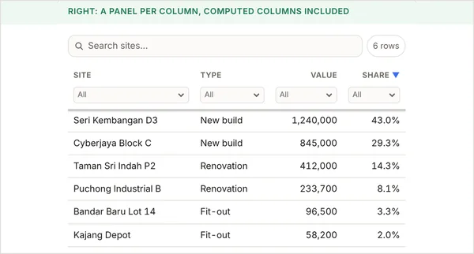</a><br><b>Tables (T)</b><br><sub>A filter is a panel per column, never a text box</sub></td>
  <td align="center" width="50%"><a href="https://kz-95.github.io/kz-skills/reference/ui-rules-visual.html#f1-nudge">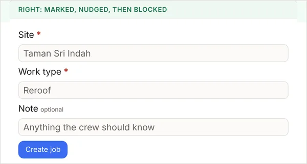</a><br><b>Forms (F)</b><br><sub>Required is said before it is missed; typing is never interrupted</sub></td>
</tr>
<tr>
  <td align="center"><a href="https://kz-95.github.io/kz-skills/reference/ui-rules-visual.html#c5-ring">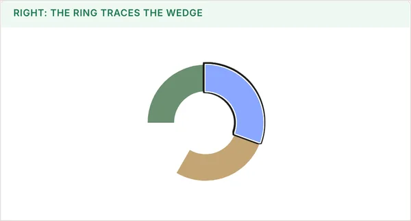</a><br><b>Charts (C)</b><br><sub>A highlight follows the mark, not a box round it</sub></td>
  <td align="center"><a href="https://kz-95.github.io/kz-skills/reference/ui-rules-visual.html#g3-lines">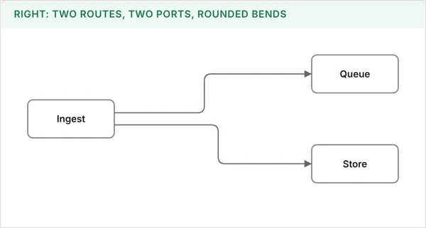</a><br><b>Diagrams (G)</b><br><sub>Square routes, one port per line, labels beside the line</sub></td>
</tr>
<tr>
  <td align="center"><a href="https://kz-95.github.io/kz-skills/reference/ui-rules-visual.html#m3-origin">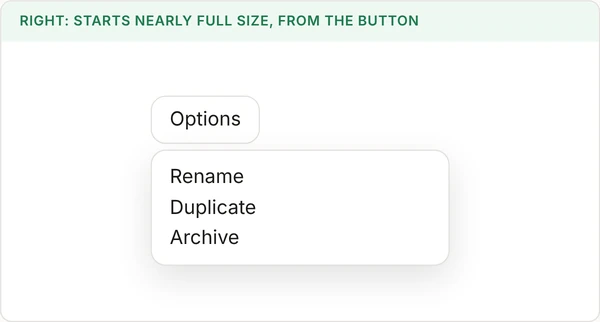</a><br><b>Motion (M)</b><br><sub>A panel grows from its trigger, never from scale(0)</sub></td>
  <td align="center"><a href="https://kz-95.github.io/kz-skills/reference/ui-rules-visual.html#l1-hierarchy">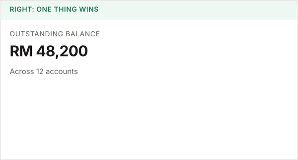</a><br><b>Layout (L)</b><br><sub>One thing wins and everything else steps back</sub></td>
</tr>
<tr>
  <td align="center"><a href="https://kz-95.github.io/kz-skills/reference/ui-rules-visual.html#n2-close">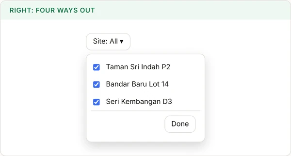</a><br><b>Overlays (N)</b><br><sub>Every panel closes four ways, including on a phone</sub></td>
  <td align="center"><a href="https://kz-95.github.io/kz-skills/reference/ui-rules-visual.html#y2-plate">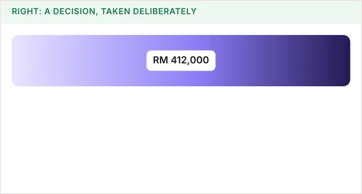</a><br><b>Type and colour (Y)</b><br><sub>Text over a changing background gets a contrast decision</sub></td>
</tr>
</table>

Also on the page: [Typing on a phone](https://kz-95.github.io/kz-skills/reference/ui-rules-visual.html#f8-typing) | [Every rule, wrong beside right](https://kz-95.github.io/kz-skills/reference/ui-rules-visual.html)

## More mistakes agents make

**De-AI: what makes an interface look machine-made**

<a href="https://kz-95.github.io/kz-skills/reference/ui-rules-visual.html#l1-hierarchy">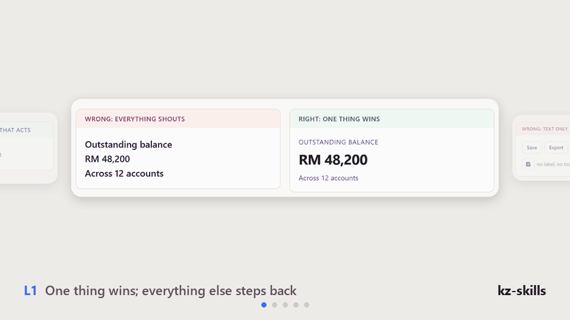</a>

**Usability**

<a href="https://kz-95.github.io/kz-skills/reference/ui-rules-visual.html#t1-filter">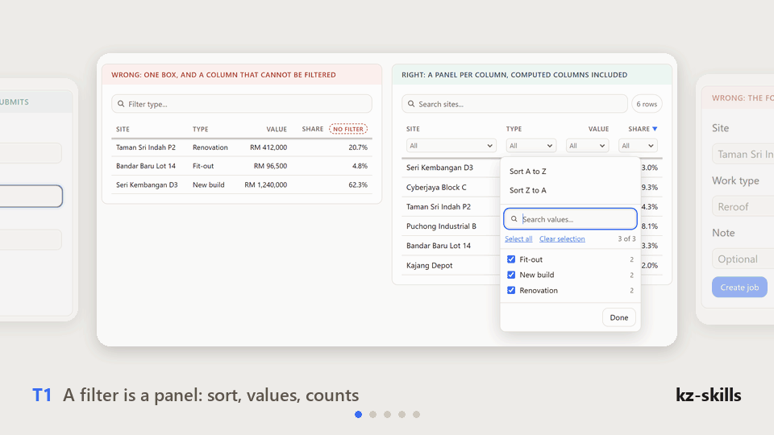</a>

**Charts**

<a href="https://kz-95.github.io/kz-skills/reference/ui-rules-visual.html#c5-ring">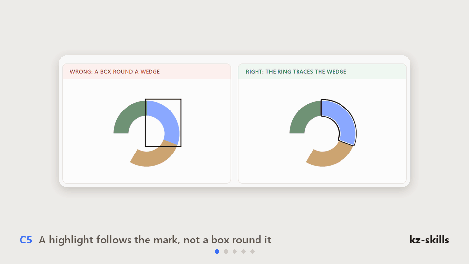</a>

## How it compares

| | No rules | A style skill, such as impeccable | kz-skills |
|---|---|---|---|
| What it decides | Whatever the model guesses | How the interface looks: type, colour, spacing, tone | What the interface must do: filters, closing, typing, focus, routes, contrast |
| "Build a table with filters" gives you | A text box under each header, most of the time | A good-looking text box under each header | A filter button per column, opening a panel with a value list and counts (`T1`) |
| How a mistake is caught | You notice it, later | You notice it, later | A paste-in browser check fails, with a code and a measurement |
| Why the agent keeps to it | It does not | Taste, which is easy to argue with | Each rule names the failure it prevents, so dropping it has a visible cost |
| Stack and look | Any | Its own look | Any stack, any look; your design system wins on style |
| Charts and diagrams | Whatever the library draws | Styled | 21 chart rules and 10 diagram rules, each with a check |

The two kinds mix well: the style skill decides how it looks, kz-skills decides what must happen, and the rules win where the two conflict ([how they combine](docs/with-impeccable.md)).

The downsides are real:

- **It does not pick a look.** There is no palette, typeface or component library here, so pair it with your design system or a style skill.
- **The checks need a browser.** They are console scripts that measure the rendered page; a screenshot or a code review cannot run them, and hover, press and focus states need the live page.

---

## The thirteen skills

Each skill, and when to reach for it:

- **[`kz-skill`](skills/kz-skill/SKILL.md)**: A request spans several of these, or it is unclear which applies. The router.
- **[`kz-uiuxrule`](skills/kz-uiuxrule/SKILL.md)**: Building, changing or reviewing any UI: the rules, in four modes (adopt, review, build, loop).
- **[`kz-motionrule`](skills/kz-motionrule/SKILL.md)**: Work that only moves - an animation, a transition, a press effect: the six motion rules and their check, without the rest of the corpus.
- **[`kz-diagramrule`](skills/kz-diagramrule/SKILL.md)**: Only a diagram: boxes, lines and labels - the ten diagram rules and their check, without the rest of the corpus.
- **[`kz-uicheck`](skills/kz-uicheck/SKILL.md)**: Before calling UI work done: ten paste-in browser checks that measure instead of judge.
- **[`kz-engrules`](skills/kz-engrules/SKILL.md)**: Any code task at all: the engineering floor everything else sits on, including how branches, commits and merges are done (rules 33-33c).
- **[`kz-fastfix`](skills/kz-fastfix/SKILL.md)**: One small job (a typo, a style change, a one-line bug): a size test, then the change made directly and checked once. No crew, no loop.
- **[`kz-flashrule`](skills/kz-flashrule/SKILL.md)**: A fast rule check in one read: the rules that break worst when missed, each with its ID and the fastest check.
- **[`kz-askcard`](skills/kz-askcard/SKILL.md)**: About to ask the user something: three to five decisions, one recommended, a custom option.
- **[`kz-crew021`](skills/kz-crew021/SKILL.md)**: A whole project, idea to maintenance, with a costed multi-agent crew.
- **[`kz-judge`](skills/kz-judge/SKILL.md)**: After the checks: the wording rules a script cannot measure (errors, button labels, empty states, delete confirmations), judged by Jev or a local Laya, only on questions each has passed on labelled examples. Costs the agent no tokens.
- **[`kz-reflect`](skills/kz-reflect/SKILL.md)**: A mistake was noticed and the fix verified: log it, classify it, and propose the rule or check change for a person to approve.
- **[`kz-loopfix`](skills/kz-loopfix/SKILL.md)**: One defect that "fix it and move on" already failed once: critic, fixer, then a gate.

Plus [`ui-glance`](skills/kz-uiuxrule/skills/ui-glance/SKILL.md), a child of `kz-uiuxrule`: a screenshot reviewed in one pass against a 22-point checklist.

## What loads when

At startup the agent sees only each skill's name and one-line description; files load only when a request matches, so the cost of having all thirteen installed is a few lines of context.

| You ask for... | Agent loads |
|---|---|
| "Build an orders table with filters" | `kz-uiuxrule` SKILL.md, `rules/INDEX.md` section T, `ui-rules.md` T1-T4 and Appendix A, `snippets/filter-table.html`, then `table-check.js` and `popover-check.js` |
| "Review this signup form" | `kz-uiuxrule` SKILL.md (review mode), `rules/INDEX.md` section F, `ui-rules.md` F1-F9, then `form-check.js` and `typing-check.js` |
| "Is this chart right?" | `kz-uiuxrule` SKILL.md, `rules/INDEX.md` section C, `chart-rules.md` (the C rules and the appendix for that chart), then `layout-audit.js` and `contrast-check.js` |
| "Draw our checkout flow" | `kz-diagramrule` SKILL.md, `diagram-rules.md`, then `diagram-check.js` at a wide width and at 375px |
| "Make this page work on a phone" | `kz-uiuxrule` SKILL.md, `rules/INDEX.md` section L, `ui-rules.md` L rules and Appendix O (the mobile shell), then `layout-audit.js` and `typing-check.js` at 375px |
| "Add a dark mode" | `kz-uiuxrule` SKILL.md, `rules/INDEX.md` section Y, `ui-rules.md` Y1-Y3, then `contrast-check.js` in both themes |
| "The filter dropdown won't close on mobile" | `kz-uiuxrule` SKILL.md, `rules/INDEX.md` section N, `ui-rules.md` N2 and Appendix J, then `popover-check.js` |
| "Add a hover animation to the cards" | `kz-motionrule` SKILL.md, `motion-rules.md`, then `motion-check.js` |
| "What's wrong with this screenshot?" | `ui-glance` SKILL.md only: one read, no rule files |
| "Is this ready to ship?" | `kz-flashrule` SKILL.md, then the checks its lines name |
| "Check the error messages" | `kz-judge` SKILL.md and `scripts/judge.py` |
| "Fix this typo" | `kz-fastfix` SKILL.md only |
| "Run the whole project" | `kz-crew021` SKILL.md, then each file in `references/` as its phase starts |
| "The agent got it wrong, learn from it" | `kz-reflect` SKILL.md and `scripts/reflect.py` |

Any code task also reads the short always-on part of `kz-engrules` (L0 and the standing rules), and a request whose purpose is unclear starts with one `kz-askcard` question.

## The rules most often missed

| ID | Rule | The&nbsp;check&nbsp;that&nbsp;fails&nbsp;it |
|---|---|---|
| `S1` | Every table ships search, sort on every column and a filter per column. A "filter" is a panel, never a bare text box. | `table-check.js` |
| `T1` | A column filter is a panel: sort, a value list with counts, a range for numbers. | `table-check.js` |
| `F8` | Typing is never interrupted. | `typing-check.js` |
| `F5` | A digit-only field selects its value when it is entered. | `rules-check.js` |
| `F6` | A field that holds an amount accepts the arithmetic that produces it. | `rules-check.js` |
| `C5` | A highlight follows the mark's own outline, never a box round it. | `layout-audit.js` |
| `B4` | Everything that acts answers the pointer, and answers the same way. | `rules-check.js` |
| `Y2` | Text over a variable background needs a contrast decision. | measured |
| `N5` | The mark showing where you are belongs to the thing it marks. | `rules-check.js` |
| `V3` | Verify the layout, not only the behaviour. | `layout-audit.js` |
| `G6` | A label sits beside its line, on an opaque plate, clear of the line and of every box. | `diagram-check.js` |

`rules-check.js` runs against the [reference page](docs/reference/README.md): it proves each right sample passes and each wrong sample still fails.
The ten checks in `kz-uicheck` run on any page.

All 94 rules, one line each: [`docs/rule-index.md`](docs/rule-index.md).

## It's working if...

- **A table request produces a filter panel, not a text box.** Each column header has a button that opens sort, a value list with counts and, for numbers, a range.
- **The agent quotes rule IDs.** It says "`F8`: the field keeps focus while the list re-renders", not "I improved the UX".
- **The agent runs the checks and pastes the output.** At a wide width, at a narrow one and at 375px with touch emulation, before it says the work is done.
- **A diagram passes `diagram-check.js`.** The console prints `clean (1 diagram(s) measured)`, not a list of `DIAGONAL` or `LABEL ON LINE` findings.
- **It asks what the work is for first.** One card, three to five options, one marked recommended, and a custom answer always open.
- **A correction becomes a proposed rule or check.** When you tell it it got something wrong, `kz-reflect` logs the mistake and suggests the change for you to approve.

## When not to use it

- **Picking a visual style or a brand, or judging hover, press and focus from a screenshot.** Those are the two downsides under [How it compares](#how-it-compares): use your design system or a style skill for the look, and the live page with the checks for the states.
- **A diagram that lives in Git and changes every sprint.** Mermaid fits that better: it is text, it diffs in a pull request, and GitHub renders it. The diagram rules are for a diagram drawn as SVG on a page.
- **Non-UI work beyond the engineering floor.** For back-end, data or infrastructure work only `kz-engrules` applies; the rest of the set has nothing to add.

## FAQ

**Does it force a visual style?**
No. The rules say what must happen, not what it looks like. Where a project has its own design system, the project's rules win.

**My agent still built a text-box filter. Why?**
The agent never read `T1`. The line every agent sees is the summary, so the summary now defines the word "filter". If you keep your own always-on instructions, put the same definition there.

**Does it mix with impeccable or another style skill?**
Yes, and **the rules win where the two conflict** (see [How it compares](#how-it-compares)). [`docs/with-impeccable.md`](docs/with-impeccable.md) lists where they agree and the three places they can pull against each other.

**Does it draw diagrams in a house style, like diagram-design?**
No. [diagram-design](https://github.com/cathrynlavery/diagram-design) gives an agent a look for diagrams; `kz-diagramrule` gives it the rules any diagram must keep, whatever it looks like, and a check that measures them. They work together.

**Can I use only the rules, not the crew?**
Yes: install `kz-uiuxrule`, `kz-engrules`, `kz-askcard` and `kz-uicheck` together (see **Only part of it** under [Install](#install)).

**Do the checks need a framework or a build step?**
No. Paste a file into the browser console.

**Does it work with GPT?**
The skills are Markdown and the hook script is host-neutral, but the hook has only been tested on Claude Code.

## Important notes

- **The purpose hook is not in the plugin yet.** It asks what a skill is for before it acts. Wire it by hand from [`skills/kz-askcard/hooks/README.md`](skills/kz-askcard/hooks/README.md).
- **Sample data uses Malaysian ringgit (`RM`).** It is sample data only.

---

## Repository map

<details>
<summary>Where everything lives</summary>

```text
skills/                          the thirteen skills, each a direct child of skills/
  kz-skill/                      the router: which skill fits the request
  kz-uiuxrule/                   the UI rules, in four modes (adopt, review, build, loop)
    rules/INDEX.md               task words to the two or three sections that apply
    rules/ui-rules.md            57 UI rules and their appendices, Appendix Z lessons
    rules/motion-rules.md        M1-M6, the one copy of the motion rules
    rules/chart-rules.md         C1-C21, choosing and wiring charts
    rules/diagram-rules.md       G1-G10, boxes, lines, labels and the budget
    rules/design-principles.md   the 16 principles behind the rules
    snippets/filter-table.html   a dependency-free table that passes every check
    skills/ui-glance/            a screenshot reviewed in one pass
  kz-motionrule/                 lane: motion-rules.md and motion-check.js only
  kz-diagramrule/                lane: diagram-rules.md and diagram-check.js only
  kz-uicheck/                    the browser checks
    checks/layout-audit.js       overflow, clipping, focus boxes, undefined tokens
    checks/table-check.js        filter panels, sort, the header block
    checks/typing-check.js       focus and caret survive every keystroke
    checks/popover-check.js      every panel closes every way
    checks/modal-check.js        a modal locks the page behind and can be left
    checks/focus-check.js        every control shows where focus is
    checks/form-check.js         every field has a label; required is marked
    checks/contrast-check.js     text contrast, in both themes
    checks/motion-check.js       transition all, ease-in, scale(0), no press state
    checks/diagram-check.js      diagonal lines, labels on lines, lines behind boxes
    scripts/run-checks.py        all checks on a local file in headless Chrome
  kz-engrules/                   engineering rules for any code, including git
  kz-fastfix/                    the fast lane for one small job
  kz-flashrule/                  the critical rules on one page
  kz-askcard/                    one card for asking the user, and the purpose hook
  kz-crew021/                    a whole project with a costed crew
  kz-judge/                      wording rules judged by a small model
  kz-reflect/                    turns a verified mistake into a proposed rule change
  kz-loopfix/                    critic, fixer and gate for one stubborn defect
docs/
  reference/                     the live wrong/right page and the checks bound to it
  rule-index.md                  every rule, one line each (generated)
  install.md                     install per host, and fixes for "it does not show up"
  with-impeccable.md             using the rules beside a style skill
  assets/                        the hero GIF, the carousels and the gallery pictures
scripts/
  validate.py                    frontmatter, links, line endings, index freshness
  build-index.py                 regenerates docs/rule-index.md from the rule files
  check-branch.py                fails a branch name that is not feat/fix/docs/chore kebab-case
  make-carousel.py               rebuilds the carousel GIFs from the reference page
  hero/                          the Remotion project that renders docs/assets/hero.gif
AGENTS.md                        how any agent uses and works in this repository
llms.txt                         the index for LLM crawlers
```

</details>

## Contributing

Contributions are welcome: a mistake an agent made, a new rule, a sharper check, a wrong/right sample, or a docs fix.
The most useful one is a real mistake, because every rule here started as one.

**Add a rule in five steps**

1. Open an issue with the real mistake and what broke because of it.
2. Write the rule in the right file under `skills/kz-uiuxrule/rules/`, with the failure it prevents and the check that catches it, using the next free ID in its category.
3. Make the check fail on a wrong sample and pass on a right one. Put the wrong/right pair on the reference page, and have `rules-check.js` assert that the wrong half still fails.
4. Run `python scripts/build-index.py`, `python scripts/validate.py` and `python scripts/check-branch.py`, and `python scripts/make-carousel.py` if a carousel sample changed.
5. Open a pull request from a branch named for the work, such as `feat/table-export-rule`.

**Ground rules, and why**

- **Rule IDs never change.** Other people's agents cite them, so a renumbered rule silently points their citations at the wrong thing. Retire a rule in place instead.
- **A check that has never failed is decoration.** Until you have seen it fail on the wrong sample, you do not know it measures anything.
- **Branch names say the work, not the tool.** A name like `fix/popover-close` tells a reviewer what changed; a tool or session name tells them nothing.
- **ASCII and LF only.** Curly quotes, em dashes and CRLF line endings break diffs, greps and some agents' edits.

The full working rules are in [`AGENTS.md`](AGENTS.md).

## Star history

<a href="https://www.star-history.com/#kz-95/kz-skills&Date">
  <picture>
    <source media="(prefers-color-scheme: dark)" srcset="https://api.star-history.com/svg?repos=kz-95/kz-skills&type=Date&theme=dark">
    <source media="(prefers-color-scheme: light)" srcset="https://api.star-history.com/svg?repos=kz-95/kz-skills&type=Date">
    
  </picture>
</a>

## License

Apache-2.0 with the [Commons Clause](https://commonsclause.com/). See [`LICENSE`](LICENSE).

**You may** use it, change it, and use it in commercial work: build your own products with these rules, use them inside your company, and share your changes.

**You may not** sell it: you cannot charge third parties for the software itself, or for hosting, consulting or support whose value comes substantially from it. The Commons Clause defines "Sell" in the `LICENSE` file; if your case is not obvious, ask first.

This makes it *source-available*, not open source in the OSI sense, so GitHub will not show an "Apache-2.0" badge.

## Credits

Diagram rules G3-G6 and the diagram complexity budget are adapted from [diagram-design](https://github.com/cathrynlavery/diagram-design) by Cathryn Lavery (MIT).
